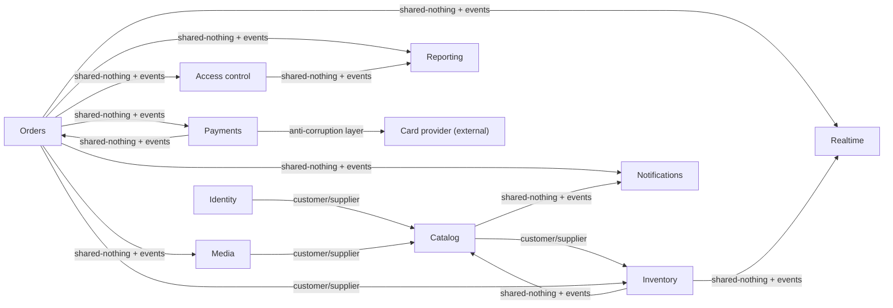

# Event storm — every business event in zenith's life

Rough time order. Past tense. No filtering, no grouping yet.

## Raj sets things up

1. OrganizerSignedUp — Raj created his login account on zenith.
2. OrganizationCreated — Raj registered his jazz club as a business on the platform.
3. OrganizerLoggedIn — Raj signed in and proved who he is.
4. VenueCreated — Raj added the hall where his shows happen.
5. EventCreated — Raj started a new show entry ("Jazz Night, 14 March"); still a private draft.
6. EventDescriptionEdited — Raj changed the wording of his draft show.
7. PriceTierDefined — Raj set a price level, like "front rows ₹2000, back rows ₹800".
8. PriceTierChanged — Raj later changed one of those prices.
9. SeatMapFileUploaded — Raj uploaded the spreadsheet listing every seat in the hall.
10. FileVirusScanPassed — the platform checked an uploaded file is safe; it was.
11. FileRejected — an uploaded file was refused (unsafe, or not what it claimed to be).
12. SeatMapImported — the platform finished reading the spreadsheet and now knows every seat.
13. SeatMapImportFailed — the spreadsheet could not be read (broken rows, wrong format).
14. PosterImageUploaded — Raj uploaded the show's poster picture.
15. PosterThumbnailGenerated — a small preview version of the poster was created for list pages.
16. EventPublished — Raj pressed Publish; the show became visible to the public.
17. SeatRecordsCreated — one record per seat (all 500) was created, so each seat can be sold exactly once.
18. EventDetailsUpdated — Raj edited the show after it was already public.
19. EventRescheduled — the show's date or time was moved.
20. TicketSalesOpened — the clock hit the announced sale minute; buying became allowed.

## Priya gets ready to buy

21. CustomerSignedUp — Priya created her account.
22. CustomerLoggedIn — Priya signed in.
23. PasswordResetRequested — Priya forgot her password and asked for a reset link.
24. PasswordResetCompleted — Priya set a new password.
25. AccountAccessRevoked — an account's access was cut off (for example, it was stolen).
26. WaitingRoomJoined — sale day is crowded; Priya entered the online queue.
27. QueuePositionAdvanced — her place in the queue moved up ("you are number 4,312… 4,311…").
28. CustomerAdmittedFromQueue — her turn came; she was let in to buy.

## The purchase

29. SeatHeld — the seats Priya picked were reserved for her for 10 minutes while she pays.
30. SeatHoldRejected — she asked for a seat someone else got first; told "sorry, gone".
31. HoldExpired — her 10 minutes ran out unpaid; the seats went back on sale by themselves.
32. OrderPlaced — Priya pressed Buy; her order now exists (money not yet taken).
33. PaymentAttempted — the platform started trying to take her money.
34. PaymentCaptured — money actually left her card.
35. PaymentFailed — the charge did not go through (the bank said no).
36. PaymentOutcomeUnknown — the call to the card company got no answer in time; we honestly
    do not know whether money moved. (Rule: find out the truth, never guess.)
37. PaymentReconciledWithProvider — we asked the card company "what actually happened?"
    and recorded the true answer.
38. PaymentWebhookReceived — the card company itself called us back later to report a result.
39. OrderConfirmed — payment succeeded; the order is final; tickets are on their way.
40. SeatAllocated — her held seats became permanently hers.
41. HoldReleased — a hold was deliberately undone early (payment failed, so the seats
    return to sale immediately instead of waiting out the 10 minutes).
42. OrderFailed — the purchase as a whole did not happen; everything already done for it was undone.
43. OrderCancelled — an existing order was called off on purpose.
44. RefundIssued — money was sent back to Priya.
45. PartialRefundIssued — part of the money was sent back, not all of it.

## Tickets and messages

46. TicketIssued — Priya's ticket now officially exists.
47. TicketPdfGenerated — the printable PDF with the QR code was created.
48. ConfirmationEmailSent — the "here are your tickets" email went out.
49. EmailDeliveryFailed — one attempt to deliver an email did not work.
50. NotificationRetryScheduled — the platform decided to try sending again later
    (waiting a little longer after each failure).
51. NotificationParkedForHumanReview — after too many failed tries, the message was set
    aside for a person to look at, instead of being silently thrown away.
52. DuplicateNotificationSuppressed — the platform noticed it had already sent this exact
    message and refused to send it twice.
53. EventSoldOut — the last seat was taken; nothing left to sell.

## At the venue door

54. TicketScanned — gate staff pointed the scanner at a ticket's QR code.
55. EntryGranted — the ticket was real and unused; the person walked in.
56. DuplicateScanRejected — the same ticket was scanned a second time; refused (already used).
57. InvalidTicketRejected — a fake or unknown ticket was refused.

## When things change, and the nightly tidy-up

58. EventCancelled — the whole show was called off; everyone who bought must be told and repaid.
59. DunningReminderSent — a chasing message about money that failed or is overdue
    ("your payment didn't go through — please try again"). Dunning = politely chasing owed money.
60. NightlyReconciliationCompleted — the nightly comparison of our money records against
    the card company's records finished.
61. PaymentDiscrepancyFlagged — that comparison found a mismatch (we say paid, they say
    not — or the reverse); flagged for a human.
62. ScanLogRollupCompleted — the nightly job that turns thousands of individual door scans
    into summary numbers finished.
63. DailySalesReportGenerated — Raj's "how did yesterday go" numbers were prepared.

Identity — 1, 2, 3, 21, 22, 23, 24, 25 (accounts, logins, resets, revocation)
Catalog — 4, 5, 6, 7, 8, 16, 18, 19, 20, 58 (the show's own life: created, described, priced, published, moved, cancelled, sales opened)
Inventory — 17, 29, 30, 31, 40, 41, 53 (seats: created, held, rejected, expired, allocated, released, sold out)
Access control — 54, 55, 56, 57 (the door: scans and their verdicts) — see the note below.
Orders — 32, 39, 42, 43, 46 (the purchase's life, including "ticket officially exists")
Payments — 33, 34, 35, 36, 37, 38, 44, 45, 59, 60, 61 (money in, money back, the unknown case, the nightly truth-checks, the chasing reminders)
Media — 9, 10, 11, 12, 13, 14, 15, 47 (files: uploads, scans, imports, thumbnails, the ticket PDF)
Notifications — 48, 49, 50, 51, 52 (messages: sent, failed, retried, parked, deduplicated)
Realtime — 26, 27, 28 (the sale-day queue)
Reporting — 62, 63 (yesterday's numbers)

## Words that change meaning between contexts

**ticket**
- Catalog: a kind of ticket — a price level with a name and a price (no owner, nothing to scan)
- Orders: one line of a purchase — this seat at this price in this order
- Access control: the scannable credential — a QR code, real-or-fake, used-or-unused

**event**
- Catalog: the show itself — Jazz Night, 14 March, with description and poster
- Everywhere else in our docs: a fact that happened — OrderPlaced, SeatHeld

**seat**
- Catalog: a position on the venue map — row A number 12, balcony tier
- Inventory: a sellable unit with a status — free, held (by whom, until when), or sold

**customer**
- Identity: an account that can log in — email and password
- Orders: the buyer — who owes or paid money
- Notifications: a recipient — a name and an address to send messages to

# Zenith's bounded contexts and context map — the complete guide

This document explains, from zero, how zenith is split into ten groups and why
the lines between them exist. Every term is defined the first time it is used,
and the table below collects them all in one place. Read top to bottom once;
afterwards it works as a reference.

## 1. The words used in this document

| Word | Plain meaning |
| --- | --- |
| **Business event** | A fact that happened, written in past tense, that someone in the business cares about. "SeatHeld" is one. A mouse click is not. |
| **Event storm** | The exercise of listing every business event in the system's life, in rough time order, before writing any code. Ours produced 63 facts (see `event-storm.md`). |
| **Bounded context** (or just **context**) | A group of business events and data that belong together because they must be correct *together*, run by one part of the system. Inside one context every word has exactly one meaning. |
| **Context map** | The picture of all bounded contexts (boxes) and how they exchange things (labelled arrows). This document builds that picture. |
| **Owns** | Data is *owned* by a context when only that context is allowed to write it. Everyone else may at most keep a copy they know can be slightly old. |
| **Question** | One context asking another for something and **waiting** for the answer before it can continue. "Can I hold seat A12?" |
| **Announcement** | One context stating a fact it just recorded, **without waiting** for anyone. "An order was confirmed." Whoever cares reacts in their own time. |
| **Transaction** | An all-or-nothing write: several changes land together, or none of them land. |
| **Transactionally consistent** | Two facts kept so tightly in step that there is never an instant where one is true and the other is not. Possible only inside one transaction. |
| **Stale** | Slightly out of date. A browse page saying "12 seats left" when the truth just became 10 is stale. Staleness is harmless where the business says it is. |
| **Customer/supplier** | A line kind: one context (the customer) cannot do its job without what the other (the supplier) provides, so the customer's needs shape what the supplier must offer. |
| **Shared-nothing + events** | A line kind: the two contexts share no database and no code; the only thing that crosses is announcements. The sender never waits; the receiver catches up. |
| **Anti-corruption layer** | A line kind used only at the border to an outside company: a translation wall where their words and message shapes are converted into ours, so their vocabulary never enters our code. |
| **Hold** | A short reservation: seats kept for one person for 10 minutes while they pay. It expires by itself. |
| **Price tier** | A named price level of one show, like "front rows ₹2000, back rows ₹800". |
| **Seat map** | The description of every physical seat in a venue — sections, rows, seat labels. |
| **Mermaid** | A small text language for diagrams. The diagram in section 6 is written in it; GitHub renders it as a picture automatically. |

## 2. Where the boxes came from

We did not start from boxes. We started from the 63 facts of the event storm
and asked **one question** for every pair of facts:

> Must these two facts become true at the same instant — inside one
> all-or-nothing transaction?

Facts that answered "yes" to each other were pulled into the same group. Facts
that answered "no" were allowed to live apart. The ten groups that fell out of
that sorting are the bounded contexts below.

One warning before the list: a bounded context is **not** the same thing as a
microservice. A context is about meaning and consistency; a service is about
deployment. Three zenith proofs: the Payments context lives *inside*
order-service until Phase 6 splits it out; the Access control context lives
*inside* inventory-service; the Reporting context may never get a service of
its own at all.

## 3. The ten contexts, opened one by one

Each context gets: its job in one sentence, who uses it, the data it owns, and
the events from the storm that happen inside it (numbers match
`event-storm.md`).

### Identity

**Job:** knows who everyone is, and proves it at login.
**Used by:** Raj, Priya, and every other context (they all need "who is this?").
**Owns:** accounts, scrambled passwords, roles (who may organize shows).
**Its events:**

- 1 OrganizerSignedUp — Raj created his login account.
- 2 OrganizationCreated — Raj registered his jazz club as a business.
- 3 OrganizerLoggedIn — Raj signed in and proved who he is.
- 21 CustomerSignedUp — Priya created her account.
- 22 CustomerLoggedIn — Priya signed in.
- 23 PasswordResetRequested — Priya asked for a reset link.
- 24 PasswordResetCompleted — Priya set a new password.
- 25 AccountAccessRevoked — an account's access was cut off.

### Catalog

**Job:** the public face of every show — what, where, when, at which price tiers.
**Used by:** Raj to manage shows; Priya to browse them.
**Owns:** venues, events (the shows), price tiers, event status
(draft / published / cancelled).
**Note:** this is the first service built, in Phase 1.
**Its events:**

- 4 VenueCreated — Raj added the hall where his shows happen.
- 5 EventCreated — Raj started a new show entry; still a private draft.
- 6 EventDescriptionEdited — Raj changed the wording of his draft.
- 7 PriceTierDefined — Raj set a price level.
- 8 PriceTierChanged — Raj later changed one of those prices.
- 16 EventPublished — Raj pressed Publish; the show became visible to all.
- 18 EventDetailsUpdated — Raj edited the show after it was public.
- 19 EventRescheduled — the show's date or time was moved.
- 20 TicketSalesOpened — the clock hit the sale minute; buying became allowed.
- 58 EventCancelled — the whole show was called off.

### Inventory

**Job:** the single truth about who has which seat.
**Used by:** nobody directly — other contexts ask it; Priya feels it as
"seat taken" or "seat yours".
**Owns:** one record per physical seat, and every hold with its expiry time.
**Note:** the Access control context also runs inside this service for now.
**Its events:**

- 17 SeatRecordsCreated — one record per seat was created, so each seat can be
  sold exactly once.
- 29 SeatHeld — Priya's chosen seats were reserved for her for 10 minutes.
- 30 SeatHoldRejected — someone else got the seat first; told "sorry, gone".
- 31 HoldExpired — the 10 minutes ran out unpaid; seats went back on sale.
- 40 SeatAllocated — her held seats became permanently hers.
- 41 HoldReleased — a hold was undone early (for example, payment failed).
- 53 EventSoldOut — the last seat was taken.

### Orders

**Job:** Priya's purchase as one story with a clear status.
**Used by:** Priya at checkout; Raj indirectly (each sale is an order).
**Owns:** orders, their lines (which event, which tier, how many), their
totals, their statuses.
**Note:** the Payments context also runs inside this service until Phase 6.
**Its events:**

- 32 OrderPlaced — Priya pressed Buy; the order exists, money not yet taken.
- 39 OrderConfirmed — payment succeeded; the order is final.
- 42 OrderFailed — the purchase did not happen; everything done was undone.
- 43 OrderCancelled — an existing order was called off on purpose.
- 46 TicketIssued — Priya's ticket now officially exists.

### Payments

**Job:** the truth about money — every attempt, every outcome, every doubt
chased until resolved.
**Used by:** nobody directly; it reacts to orders and talks to the card company.
**Owns:** the money ledger — what we tried to charge and what truly happened.
**Its events:**

- 33 PaymentAttempted — the platform started trying to take the money.
- 34 PaymentCaptured — money actually left Priya's card.
- 35 PaymentFailed — the bank said no.
- 36 PaymentOutcomeUnknown — no answer in time; we honestly do not know whether
  money moved. Rule: find out the truth, never guess.
- 37 PaymentReconciledWithProvider — we asked the card company what actually
  happened and recorded the true answer.
- 38 PaymentWebhookReceived — the card company itself called us back later with
  a result.
- 44 RefundIssued — money was sent back.
- 45 PartialRefundIssued — part of the money was sent back.
- 59 DunningReminderSent — a polite chasing message about failed or owed money.
- 60 NightlyReconciliationCompleted — the nightly comparison of our money
  records against the card company's finished.
- 61 PaymentDiscrepancyFlagged — that comparison found a mismatch; flagged for
  a human.

### Media

**Job:** files in, safe useful files out.
**Used by:** Raj (uploads), and other contexts that need the processed results.
**Owns:** stored files and what was made from them — thumbnails, imported seat
lists, ticket PDFs.
**Its events:**

- 9 SeatMapFileUploaded — Raj uploaded the spreadsheet listing every seat.
- 10 FileVirusScanPassed — the platform checked the file is safe; it was.
- 11 FileRejected — an uploaded file was refused.
- 12 SeatMapImported — the platform finished reading the spreadsheet.
- 13 SeatMapImportFailed — the spreadsheet could not be read.
- 14 PosterImageUploaded — Raj uploaded the show's poster picture.
- 15 PosterThumbnailGenerated — a small preview of the poster was created.
- 47 TicketPdfGenerated — the printable PDF with the QR code was created
  (a QR code is the square barcode the gate scanner reads).

### Notifications

**Job:** messages that always *eventually* arrive and never block a sale.
**Used by:** nobody directly; it reacts to facts from other contexts.
**Owns:** what was sent to whom, and the retry bookkeeping.
**Its events:**

- 48 ConfirmationEmailSent — the "here are your tickets" email went out.
- 49 EmailDeliveryFailed — one delivery attempt did not work.
- 50 NotificationRetryScheduled — it will try again later, waiting a little
  longer after each failure.
- 51 NotificationParkedForHumanReview — after too many failures, set aside for
  a person instead of being silently dropped.
- 52 DuplicateNotificationSuppressed — an already-sent message was refused a
  second send.

### Realtime

**Job:** live updates to screens that are open right now, plus the sale-day
waiting queue.
**Used by:** Priya's browser, while a page is open.
**Owns:** who is connected, and queue positions.
**Its events:**

- 26 WaitingRoomJoined — sale day is crowded; Priya entered the online queue.
- 27 QueuePositionAdvanced — her place moved up.
- 28 CustomerAdmittedFromQueue — her turn came; she was let in to buy.

Notice: the whole queue story starts and ends inside this one context. A box
can have a busy life with few lines.

### Access control

**Job:** the venue door — every real ticket enters exactly once.
**Used by:** gate staff with scanners.
**Owns:** the scannable tickets and the moment each one was used.
**Note:** lives inside inventory-service for now; still its own context,
because at the door "ticket" means a scannable credential, nothing more.
**Its events:**

- 54 TicketScanned — staff pointed the scanner at a ticket's QR code.
- 55 EntryGranted — real and unused; the person walked in.
- 56 DuplicateScanRejected — same ticket a second time; refused.
- 57 InvalidTicketRejected — fake or unknown; refused.

### Reporting

**Job:** yesterday's numbers for Raj.
**Used by:** Raj, each morning.
**Owns:** summary tables built overnight.
**Note:** may never become its own service; the context still deserves its own
boundary because its words ("daily total") mean nothing anywhere else.
**Its events:**

- 62 ScanLogRollupCompleted — thousands of door scans were turned into summary
  numbers.
- 63 DailySalesReportGenerated — Raj's "how did yesterday go" numbers were
  prepared.

## 4. How a line between two boxes is decided

A line is **not** drawn because two contexts feel related, share a noun, or
might talk someday. One rule only:

> A line exists only where the story forces one context to **send** something
> to another. There are exactly two things it can send: a **question** it
> needs answered now, or an **announcement** of a fact it just recorded.

You find the lines by replaying the 63 facts in order and asking at each one:
*could this context have recorded this fact using only its own data — or did
something have to arrive from outside?*

Three consequences:

1. **Arrow direction.** The arrow points the way the question or announcement
   travels: from sender to receiver. When different messages travel both ways
   (Orders and Payments), both arrows are drawn.
2. **Silence is the default.** Ten boxes make 45 possible pairs; only 13 pairs
   earn a line. Media and Payments never exchange anything in all 63 facts —
   no line. Even Payments and Inventory have no line: when a payment fails,
   the news reaches the seats *through Orders* (Payments announces 35
   PaymentFailed → Orders reacts and asks Inventory to release the hold, 41).
   If the story never makes two contexts talk, the map must not connect them.
3. **The label.** Each line carries one of three kinds. Decide with the
   switch-off test: *what happens to the receiver if the sender goes quiet for
   an hour?*
   - Receiver is **stuck** — its job cannot start or finish without what the
     sender provides → **customer/supplier**. The needing side is the
     customer, the providing side the supplier.
   - Receiver only gets **stale or late** — everyone's job still completes,
     and the receiver catches up when announcements resume →
     **shared-nothing + events**.
   - The other side is **not ours** — an outside company whose words we do not
     control → **anti-corruption layer**: translate at the border, never let
     their vocabulary in.

## 5. Every line, derived from the story

**While Raj sets things up:**

- **Identity → Catalog** · customer/supplier. Catalog must know "this really
  is Raj, a verified organizer" before accepting a show. Identity off =
  nobody logs in = Catalog turns everyone away. Stuck, so customer/supplier;
  Catalog is the customer. (Identity supplies this proof to every context;
  one representative arrow keeps the map readable.)
- **Media → Catalog** · customer/supplier. Catalog's pages need the poster
  thumbnail (15) and the imported seat list (12) Media produces from Raj's
  uploads (9, 14). Catalog's needs dictate what Media must deliver.
- **Catalog → Inventory** · customer/supplier. At 16 EventPublished, Catalog
  announces "show live — here are its seats", and Inventory builds its seat
  records (17) from that. Catalog off = Inventory has nothing to build from.

**While Priya buys:**

- **Orders → Inventory** · customer/supplier — the strongest line on the map.
  Orders sends a question — "hold A12 and A13?" — and **waits** for yes (29)
  or no (30) before telling Priya anything. The same line later carries
  "release that hold" (41) when a payment fails.
- **Orders → Payments** · shared-nothing + events. 32 OrderPlaced is
  announced; Payments reacts by charging (33). Orders does not wait — the
  order honestly sits at "placed, awaiting payment".
- **Payments → Orders** · shared-nothing + events. Money news (34 captured /
  35 failed) is announced back; Orders reacts with 39 OrderConfirmed or
  42 OrderFailed.
- **Payments → Card provider** · anti-corruption layer. The only box we do
  not own. Their message shapes stop at the translation wall and become our
  facts 34–38.
- **Inventory → Catalog** · shared-nothing + events. Holds, expiries,
  allocations (29, 31, 40, 53) are announced so browse pages keep "seats
  remaining" roughly right. Inventory quiet = the number goes stale — which
  the business explicitly allows on browse pages.
- **Inventory → Realtime** · shared-nothing + events. "A12 was just taken" →
  the seat turns grey on open screens.
- **Orders → Realtime** · shared-nothing + events. "Order confirmed" →
  Priya's open page flips to success.

**After the money lands:**

- **Orders → Media** · shared-nothing + events. 46 TicketIssued is announced;
  Media builds the PDF (47) a little later. Nobody waits at checkout for a PDF.
- **Orders → Notifications** · shared-nothing + events. Same announcement →
  the confirmation email (48). Late but never blocking.
- **Orders → Access control** · shared-nothing + events. 46 TicketIssued →
  the door's list learns the new QR code, hours or days before doors open.
- **Orders → Reporting** · shared-nothing + events. Sales facts flow in;
  tonight's job counts them into tomorrow's report (63).

**When things change, and at night:**

- **Catalog → Notifications** · shared-nothing + events. 58 EventCancelled →
  every buyer gets told. Cancelling must not wait for thousands of emails.
- **Access control → Reporting** · shared-nothing + events. Door scans
  (54–57) → the nightly rollup (62).

Sixteen lines, thirteen talking pairs, thirty-two silent pairs. Every line
exists because a numbered fact could not have been recorded without it.

## 6. The map

Boxes are bounded contexts. Arrows point the way questions or announcements
travel. Labels carry the relationship kind from section 4.

Note: Identity really supplies signed login proof to **every** context; one
representative arrow is drawn to keep the map readable.

## 7. Why every boundary is allowed to exist

A boundary is only correct if the moment of drift it allows is harmless for
the business. One sentence per talking pair proves it, using this template:

> Separate because ___ does not need to be transactionally consistent with ___.

- **Catalog | Inventory:** the published show description does not need to be
  transactionally consistent with the count of seats currently held.
- **Orders | Payments:** an order may honestly sit at "placed, awaiting
  payment" while the charge is still being attempted; the gap is designed.
- **Identity | Catalog:** an account existing does not need to be
  transactionally consistent with a show being published.
- **Catalog | Media:** a show's details do not need to be transactionally
  consistent with its poster thumbnail being ready.
- **Catalog | Notifications:** a show being cancelled does not need to be
  transactionally consistent with every buyer having been told yet.
- **Inventory | Orders:** a hold on seats does not need to be transactionally
  consistent with the order that will claim them — the 10-minute hold itself
  protects the gap.
- **Inventory | Realtime:** a seat becoming held does not need to be
  transactionally consistent with watchers' screens having greyed it out.
- **Orders | Media:** an order being confirmed does not need to be
  transactionally consistent with its PDF ticket existing yet.
- **Orders | Notifications:** an order being confirmed does not need to be
  transactionally consistent with the confirmation email having been sent.
- **Orders | Realtime:** an order's true status does not need to be
  transactionally consistent with Priya's page showing it yet.
- **Orders | Reporting:** today's sales do not need to be transactionally
  consistent with the report totals, which are built overnight.
- **Orders | Access control:** a ticket being issued does not need to be
  transactionally consistent with the gate's list knowing it yet — the gap
  closes long before event day.
- **Access control | Reporting:** a scan at the door does not need to be
  transactionally consistent with the nightly scan summary.
- **Payments | Card provider:** our record of a charge does not need to be
  transactionally consistent with the provider's record — the nightly
  comparison (60) finds the truth.

If one of these sentences could not be written honestly, the boundary it
describes would be wrong, and the map would have to change.